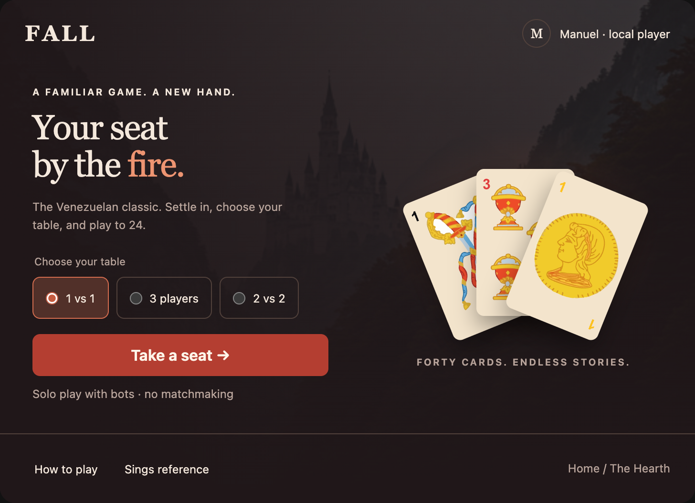
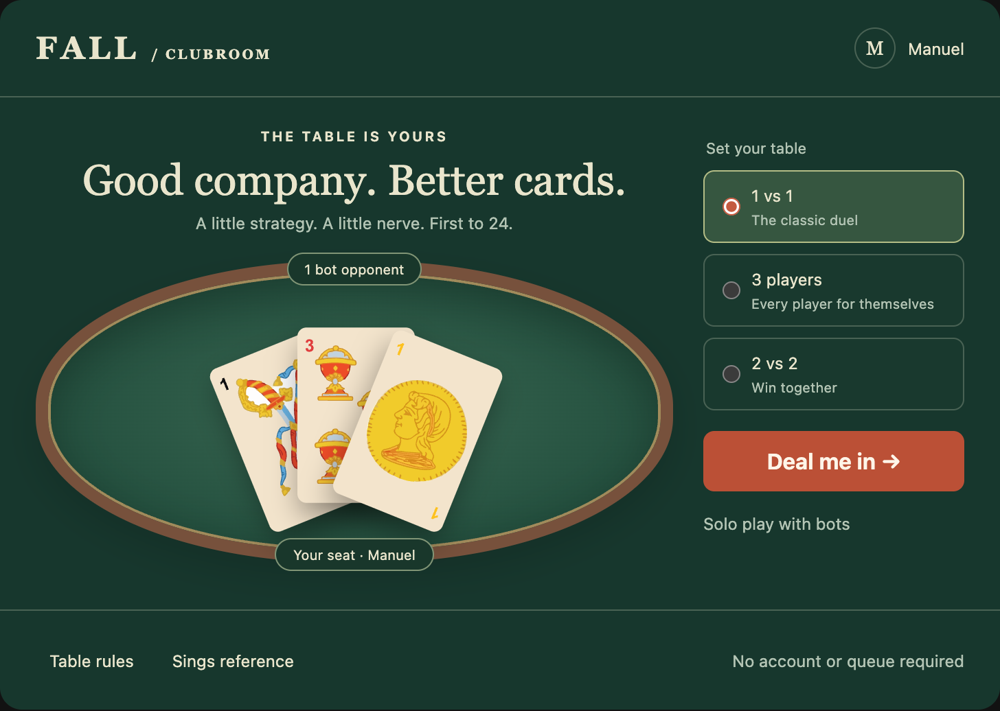
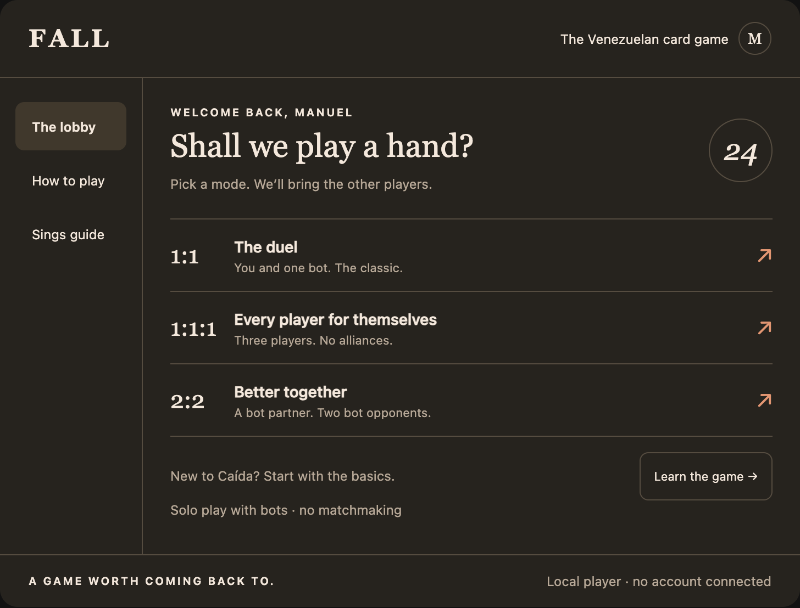

# Home lobby exploration · GHI#80

> **Updated direction:** adventure RPG with cards and many future modes.
> The Hearth visual family is preferred. See [the adventure hub iteration](adventure-hub.md)
> and open `adventure-hub.html` for three revised world-based compositions inspired
> by the supplied reference. The menu-first options below are retained as history.

Status: **design review, not a production implementation**. Issue #80’s title
is the intent; its older minimal-skeleton scope is not the design brief for this
iteration. No final direction is selected yet.

Open `mockups.html` directly in a browser. No server, dependency install, login,
or build is needed. All imagery is referenced from existing repository assets.
The examples use a fictional local player named Manuel, not account data.
Controls are local simulations: nothing starts a game or persists data.

## Current home analysis

- `src/infrastructure/ui/screens/Home.tsx` is a centered title, description,
  badge, development playground link, bottom navigation, and welcome dialog.
  It has no scene composition or visible game-mode entry points.
- `BottomNavbar.tsx` puts the primary Play action in a fixed bottom bar.
  Play opens `BottomSidebar.tsx`, a full-height, three-column mode sheet.
  The extra step hides the actual choices. Equal-width columns can squeeze
  descriptions on narrow screens.
- Profile, Daily, and Settings only update the active navigation state. They
  do not open real features. The redesign should not promote these as working
  destinations or invent rewards, currency, progression, or friends services.
- Rules and Sings already navigate to `/rules` and `/sings`; retain them.
  Theme switching and the development-only playground also need to survive
  the eventual implementation, though these sketches omit their controls.
- `WelcomeModal.tsx` initializes a local user in `FALL_USER`. The login screen
  is a separate visual flow; do not assume backend authentication exists.
  Keep user initialization before calling the game setup service.
- `GameService.ts` supports `1vs1`, `1vs2`, and `2vs2`, with bots by default.
  Label `1vs2` as **3 players / free-for-all**, not a two-against-one team.
  Do not imply online rooms, a live player count, invites, or matchmaking.
- The recent login establishes a cinematic castle backdrop, warm red/ember
  accents, Cinzel headings, and Spline Sans body copy. The card art is Spanish
  suits, not a poker deck. Existing artwork can connect the lobby to that world.

## Three directions

### A · The Hearth — recommended starting point

Cinematic arrival with subdued existing castle imagery and a fan of existing
Spanish cards. One primary action follows an inline mode selector. Utility
navigation stays quiet at the bottom. The layout stacks artwork above the
controls on mobile. Best continuity with the login; avoids turning the lobby
into a dashboard. Risk: art can push actions below the fold on small screens;
keep the mobile still life shallow in the final scene.

### B · The Clubroom

A felt table is the home scene itself. The seating preview responds to the mode
picker; the setup panel sits beside the table on desktop and below it on mobile.
Best for a tactile, game-first identity and later subtle card animation.
Risk: a spatial lobby could be mistaken for an active match. Keep the setup
action and preview state explicit, and start with CSS/static art, not WebGL.

### C · The Field Guide

An editorial hub with direct mode rows, compact navigation, and an easy learning
entry point. The rail becomes a horizontal navigation row on mobile. Best for
fast repeat visits, legibility, and a low-cost responsive implementation.
Risk: less continuity with the atmospheric login; reintroduce the final product
heading font and restrained ember accents if this direction wins.

The prototypes use system/Georgia fallbacks to remain offline and self-contained
apart from repository artwork. They explore hierarchy and composition, not final
Cinzel/Spline font metrics or the complete light/dark token system. Browser
appearance follows the OS, with Clubroom intentionally maintaining felt colors.

## Refactor boundary after design approval

1. Keep `HomeScreen` as the route entry; compose a home module with a scene
   shell, player identity, mode controls, play action, and utility navigation.
   Mirror the existing `src/modules/login/ui` organization.
2. Extract shared typed mode metadata rather than duplicate mode IDs, labels,
   and descriptions between the home scene and legacy mode sheet. Keep one
   user-initialization-aware game-start action using the existing service.
3. Separate decorative scenery from interactive HTML. Decorative layers must
   not intercept input; the primary action must work without animation/WebGL.
4. Preserve the current welcome/local-user behavior, routes, theme control,
   development-only playground, and production exclusion of development tools.
5. Replace home navigation only after checking other consumers of the existing
   navbar. Do not refactor the gameplay scene or add speculative social systems.

## Implementation acceptance checks

- Keyboard and touch can choose every mode and reach Play, Rules, and Sings.
- Each mode passes its existing domain ID to the game setup service exactly
  once, after a local user exists, and reaches `/game`.
- Three-player copy describes free-for-all; team copy describes 2 vs 2.
- New-user, returning-user, pending-start, and failed-start states are explicit;
  no accidental double start and no placeholder control pretending to work.
- No clipping at 320px, phone landscape, tablet, and desktop; controls have
  44px touch targets, safe-area spacing, visible focus, and readable contrast.
- Light/dark appearance, reduced motion, and animation fallback are verified.
- Add focused home/mode tests alongside the existing Vitest/Testing Library
  tests; run the suite and production build before marking the PR ready.

## Review decisions

Choose a base composition (A/B/C), preferred navigation, and whether mode choice
should be inline with one Play button or a direct action per mode. Mixing the
Hearth atmosphere with the Field Guide’s direct rows is also a sensible option.
Online play, rewards, profiles, and progression remain separate product decisions.

## Validation for this design iteration

- Headless Chrome: all three mockups load their repository artwork without
  JavaScript errors; no horizontal overflow at 320, 390, 728, or 1280px in light
  and dark appearance; buttons and mode labels meet 44px minimum heights.
- Mode selection, Clubroom seating updates, simulated play actions, and
  reference navigation feedback are exercised. These are not gameplay tests.
- `pnpm check` passes; `pnpm exec vp test run` passes all 261 tests in 51 files;
  `pnpm run build` passes. Existing Three.js deprecation and bundle-size
  warnings remain outside this design-only change.
- The checked-in previews capture the dark appearance at 728px. Open the HTML
  to explore responsive layouts and the local interactions.
