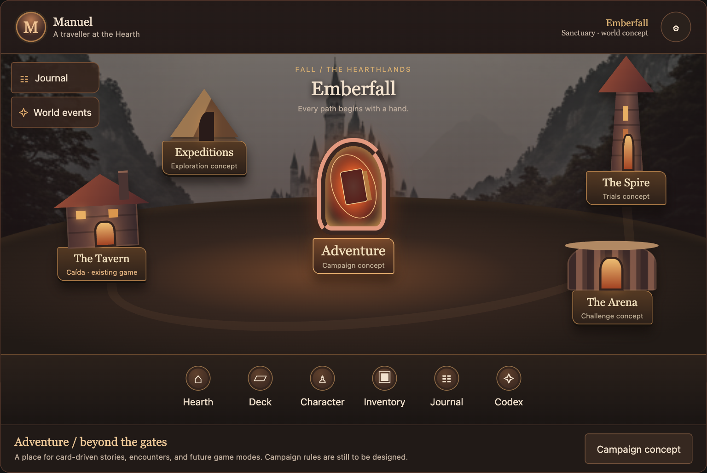
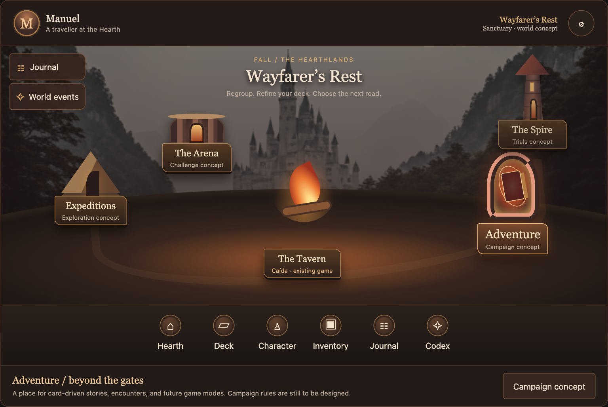
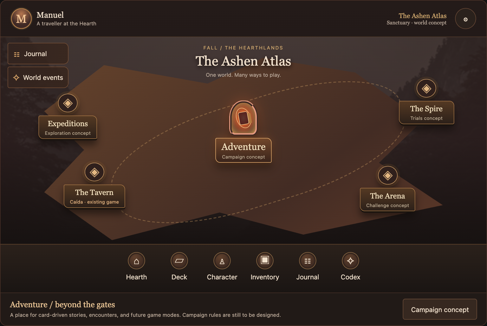

# Hearthlands · adventure hub iteration

## Updated product direction

Fall is an **adventure RPG with cards and many future game modes**, not simply
a lobby for three variants of Caída. Keep the original **Hearth** palette and
atmosphere: charcoal, dark wine, ember orange, aged bronze, and warm parchment.
The supplied reference informs the **composition**, not its bright palette,
characters, commercial mechanics, or exact buildings.

This supersedes the original menu-first recommendation in `README.md`.
The original explorations stay available as history. Production remains unchanged.

Open `adventure-hub.html` and use **Explore a layout** to compare three proposed
compositions. Every landmark and dock control can be inspected; future systems
explain their role rather than pretending to be implemented. The Tavern previews
the existing Caída modes without starting a game.

## What to borrow from the reference

- **The world is the menu.** Distinct landmarks represent destinations and modes.
- **Persistent player HUD.** Identity at the top; a compact utility corner.
- **A foreground systems dock.** Deck, character, inventory, journal, and codex
  belong to the player, separate from world destinations.
- **Layered depth.** Distant mountains/castle, a navigable middle-ground, and a
  foreground sanctuary give the lobby a sense of place.
- **A visual hierarchy, not equal tiles.** Adventure is the main focal point;
  other modes have recognizable locations with quieter secondary labels.
- **Expandable districts.** More modes should join groups or regions instead of
  endlessly shrinking icons in the same screen.

Do **not** copy the reference’s currencies, energy, VIP systems, shop offers,
notification dots, countdowns, or reward cadence. Those are independent product
decisions, not prerequisites for an RPG hub.

## Three compositions, one palette

### Emberfall · town hub — recommended

Closest to the reference’s spatial structure. The central adventure gate is
surrounded by a tavern for classic Caída, a spire for proposed trials, an arena
for proposed challenges, and a road camp for proposed expeditions. The HUD and
player dock remain consistent as the world grows. Landmark names are working
labels, not a commitment to those exact game modes.

### Wayfarer’s Rest · camp hub

A more personal sanctuary: the fire is central, the tavern becomes the shared
table, and roads lead toward the proposed modes. Best if the adventurer, deck,
or eventual party should be the emotional center rather than a city. This
iteration establishes the composition; a final hero/party illustration is
intentionally not invented or borrowed from the reference.

### Ashen Atlas · realm hub

A diegetic map with readable destinations and connecting roads. Best for many
modes, future regions, and a stronger exploration loop. Keeps the same player
dock and HUD. This is a structural alternative, not a return to a dashboard.

The sketches reuse the existing castle backdrop and code-native architectural
blockouts. These are layout studies, not final environment art, character art,
iconography, or world-building. All mode labels remain live HTML for accessibility.

## Many modes: revised refactor boundary

- Use a **hub destination registry**, not a home component hardcoded to the
  current three match formats. A destination needs a stable ID, title, category,
  availability, preview copy, and scene placement. Keep those separate from
  match-format IDs such as `1vs1`.
- Separate **world destinations**, **player systems**, and **utilities**.
  The dock does not need another icon every time a new mode is introduced.
- Give the current game its own destination and reuse the existing setup flow
  inside it. Future modes can have independent entry/configuration screens.
- Support available/planned/locked states in the presentation, but do not add
  an unlock condition, player economy, or reward system without a game design.
- Keep the scene art separate from semantic buttons and the destination detail
  panel. A selectable landmark must also be reachable without precise pointing.
- For more destinations, introduce named regions or a world view; never rely on
  crowding more permanently visible hotspots into the same layout.
- On phones, reflow to labelled landmark rows/groups rather than shrink the
  landscape HUD or require exact taps on distant buildings. A future landscape
  scene can retain the spatial layout if it meets touch/accessibility checks.
- Preserve local-user initialization, rules, Sings, appearance controls, the
  development playground, and the current game behavior when implementing.

## Decisions still open

1. Town as the main home, or a personal camp with a town/world view behind it?
2. Is Adventure a campaign, a run-based journey, or another card-driven format?
3. Does the player represent one character, a party, or only a deck?
4. Which proposed systems and destinations are needed in the first playable hub?

Only the adventure/RPG direction and Hearth visual family are confirmed here.
Do not treat the example destination names as a finalized content roadmap.

## Validation

- All three layouts pass overflow and minimum 44px control-target checks at
  320, 390, 600, 728, 1024, and 1280px. Architectural blockouts do not collide
  with the scene heading at those widths.
- All destination selections update their descriptions; only the existing
  Caída destination enables its simulated mode-picker action. All three match
  formats produce preview feedback without starting games or saving state.
- Light appearance and reduced-motion checks pass, with no JavaScript errors.
  The Hearth-themed product scene intentionally remains dark in either appearance.
- `pnpm check` and `git diff --check` pass. Production code and dependencies
  remain unchanged; the earlier 261-test/build validation is documented in
  `README.md`, not claimed as a new run for this design-only iteration.
