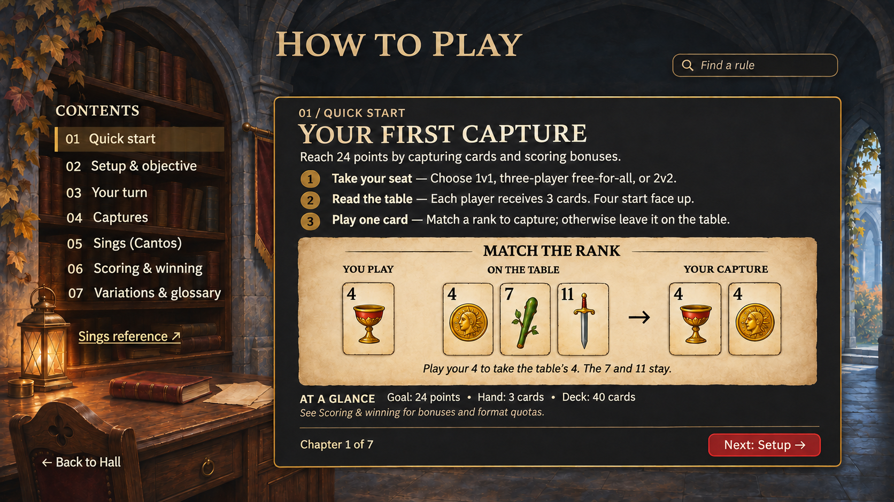
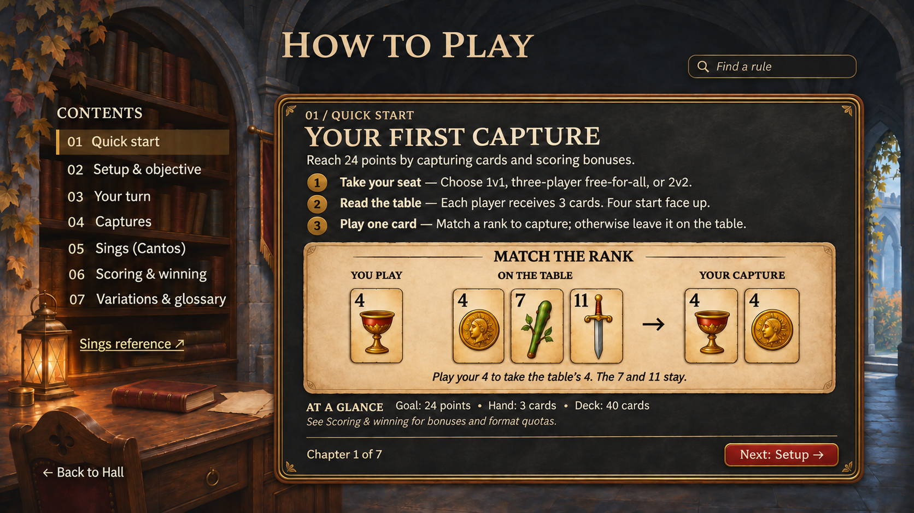
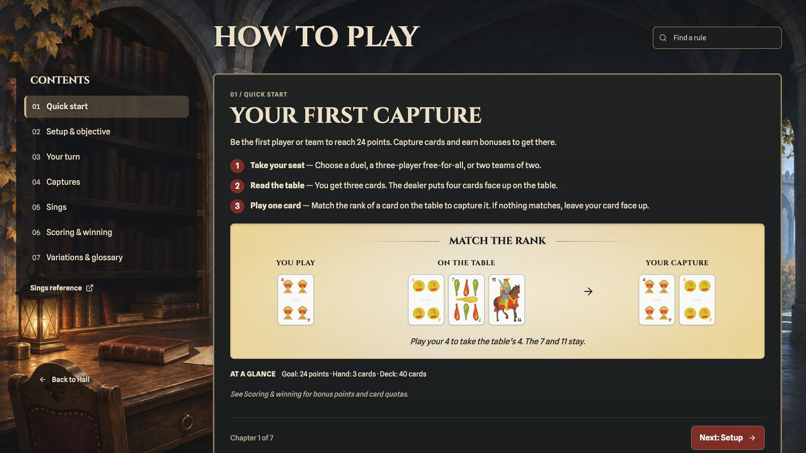

# How to Play — Card Hall rulebook study

Design research and mockups for [#103](https://github.com/Donkijote/fall/issues/103). The owner approved the open archive page composition and both visual references, with the subtitle removed. The approved simplified design is now implemented at `/rules` in the rulebook module. Gameplay rules and scoring behavior remain unchanged. The existing Rules and Sings content defines the intended first-release rules, as confirmed by the owner during this work. Engine discrepancies belong in [bug #109](https://github.com/Donkijote/fall/issues/109), not in revised teaching copy.

## Approved page composition

The initial studies enclosed the title, chapter rail and lesson in one nearly full-screen frame over the existing Hall. That silhouette read as a modal. The approved direction separates the page navigation from the reading surface and moves the guide into a distinct archive room in the same world.

| Study                                                            | Purpose                                                                                                                                                    |
| ---------------------------------------------------------------- | ---------------------------------------------------------------------------------------------------------------------------------------------------------- |
| [Approved simplified page](how-to-play-page-simple-approved.png) | Open page heading and chapter rail over a dedicated archive scene; a quiet frame encloses only the article. Approved composition and simplified treatment. |
| [Approved detailed page](how-to-play-page-detailed-approved.png) | Same page organization with more crafted material and brass detail confined to the reading surface.                                                        |
| [Clean archive background](archive-background-v1.png)            | Separate artwork-only scene master, without baked controls or text, available for later implementation export.                                             |

These are built-in ImageGen desktop studies, not browser captures or working controls. The [final edit prompts](prompts-approved.json) record subtitle removal from both approved images. The [revised prompt archive](prompts-v2.json) records the background and the preceding v2 studies; the [original archive](prompts.json) retains the initial studies. Source game screenshots informed composition but are not redistributed in this repo. The original [simplified](how-to-play-simple.png) and [detailed](how-to-play-detailed.png) studies remain available for comparison; their enclosing-shell layout is superseded.

The revised background is a quiet stone-and-oak archive adjoining the Card Hall, with recessed shelves, a low writing desk and restrained warm lamplight. It changes the location while retaining Fall's materials, lighting and painterly treatment. It must replace the main-menu scene on navigation; there is no retained Hub underneath, backdrop dismissal or scene-wide modal scrim.

### Why this reads as a page

- The single title HOW TO PLAY sits directly in the scene above the content, outside any enclosing frame. There is no subtitle; do not restore “Caída • The table guide” during implementation.
- Chapters sit in an open left navigation region. Only the selected row needs a quiet fill and selection marker; there is no framed sidebar box.
- Back to Hall occupies the page's lower-left navigation position, outside the article. This is a route action, not an X or dialog dismissal.
- Only the lesson and its examples have an opaque reading surface, offset to the right with visible scene between the rail and the article. The article frame does not wrap the page header, chapter list or Back action.
- Search belongs to the page header, while chapter Previous/Next belongs to the article footer. A compact At a glance summary can live within the article, without creating another outer shell.

This combines Armello's open index and page-level Back action with Frostpunk's locally framed article. Horizon also shows that a tutorial title and category navigation can belong to a full page without a common surrounding border. These observations concern layout only; the stills do not establish routing semantics or motion behavior in those games.

The images illustrate one chapter, not the entire rulebook. Opening-deal copy remains a summary; later deals and exceptions belong in Setup. The first-capture text is one valid action, not an exhaustive ruling on declining a capture. Production figures must use the existing Spanish-deck card component and live labels, not generated card faces. Use exact Cinzel/Spline Sans families, semantic themes and shared component radii when implemented; raster studies approximate them.

## Reference study and limits

Reviewed every file in `/Users/manuel/Developer/inspirations/how to play`: four still images, no clips. These establish layout, hierarchy and visible states. They do not establish animation durations, opening direction, hover behavior, or whether a depicted gameplay image animates. All motion below is a proposal for Fall, not an observed claim about these games.

| Local reference                         | What is visible                                                                                                                                                                          | What Fall should borrow                                                                                                                                        | What to avoid                                                                                                                        |
| --------------------------------------- | ---------------------------------------------------------------------------------------------------------------------------------------------------------------------------------------- | -------------------------------------------------------------------------------------------------------------------------------------------------------------- | ------------------------------------------------------------------------------------------------------------------------------------ |
| `armello-game-guide.jpg`                | Full-screen illustrated backdrop; long topic rail at left; selected Burning Cards row; short explanation, framed visual sequence, then supporting paragraphs; fixed Back at bottom left. | A visible index, one concept per article, illustration adjacent to the rule, stable return path. The symbolic sequence is especially useful for card captures. | Tiny all-caps reading text, a long alphabetical list as the beginner's only learning path, or text directly over detailed world art. |
| `horizon-forbidden-west-tutorial-3.png` | Notebook context, Tutorials → Traversal → Basic Moves breadcrumb, left list with Sliding selected, large gameplay example, short action text and persistent Close.                       | Distinguish category from article title; pair an action with its result; keep prose short and direct.                                                          | Copying controller prompts before Fall has supported bindings, or treating the still gameplay panel as evidence of video playback.   |
| `frostpunk-research-tutorial.jpg`       | Tutorial summary overlay, topic rail, selected Research state, large scrollable article, annotated workshop-count comparison, Close above content.                                       | Separate navigation from the scrollable reading region; label comparisons directly; make long content and exit discoverable.                                   | Deep frame nesting, full-scene transparency behind paragraphs, or decorative scrolling controls.                                     |
| `frostpunk-construction.jpg`            | Same shell; Construction selected; explanation, labeled build/dismantle icons, then valid/invalid placement comparison; content extends below viewport.                                  | Reuse a predictable article template; show valid and invalid outcomes when useful; alternate prose and small illustrations.                                    | A huge uncaptioned image that forces the reader to infer the rule.                                                                   |

Two additional first-party references broaden the teaching options. [Magic Arena's getting-started page](https://magic.wizards.com/en/mtgarena/getting-started) describes guided learning with Sparky and allows the tutorial to be skipped. [Runeterra's historical patch 2.11 notes](https://playruneterra.com/en-us/news/game-updates/patch-2-11-0-notes/) describe a structured prologue with AI practice, Challenges and later modes. The latter is historical product context, not a claim about its current UI. These support considering optional practice later; they do not justify making Fall's written guide a mandatory onboarding gate. Neither source was used to infer transition timing.

## Recommended destination

Keep `/rules` as a dedicated, route-addressable rulebook, reached from **Hub → Help → How to play**. It needs more reading space and stable links than Settings. Use the dedicated archive background, open page navigation and a nearly opaque article surface. The shared world materials connect it to the Hall without retaining the main menu behind it or placing paragraphs over detailed scenery. Avoid literal curved book pages, page-turn animation, or a huge character beside the text.

| Alternative                        | Assessment                                                                                                                                                                                      |
| ---------------------------------- | ----------------------------------------------------------------------------------------------------------------------------------------------------------------------------------------------- |
| Dedicated guide page               | Recommended. Supports chapter links, history, mobile reflow, reading position and long explanations without nested dialogs.                                                                     |
| Large modal over the Hall          | Visually plausible from Frostpunk and existing Settings, but costly for long reading, direct links and nested reference navigation. Keep modal behavior for the existing in-match Sings lookup. |
| Settings section                   | Preferences and rule learning have different purposes. Preserve the separate Help destination established in #104. If entered through Settings in future, retain a contextual return.           |
| One endlessly scrolling article    | Good for sequential reading, harder for quick lookup. Use chapters with a continuous article per chapter and a compact quick reference instead.                                                 |
| Forced wizard or playable tutorial | Future enhancement only. The first version remains written and freely navigable.                                                                                                                |

### Desktop distribution

- Page header, outside the article: HOW TO PLAY and Find a rule, without a subtitle. Keep sufficient scene visible around the heading; no enclosing top-and-bottom shell or title plaque spanning all regions.
- Open left region: numbered learning chapters and a Sings reference shortcut, with selected state conveyed by shape and text as well as color. Page-level Back to Hall sits below this navigation.
- Article on the right: chapter title, short rule blocks, one concept per figure, and captions with exact outcomes. Approximately 60–75 characters per text line; diagrams may use the full article width. Keep ornament at the boundary, never behind reading text.
- At a glance: compact summary inside the reading surface or a disclosure in its footer, containing goal, hand/deck size, Fall values and Clean Table exception. The detailed rule definitions remain in their mapped chapters.
- Article footer: chapter position and Previous/Next actions, following the numbered reading order. No completion or unlock state. Back to Hall remains a separate page-level action.

### Mobile and short landscape

At narrow widths, replace the rail with a labeled **Chapters** disclosure and current chapter name. Keep chapters directly reachable; do not make swipe the only navigation. Move At a glance into its own expandable block in the same document, never hide the only copy of a rule. Search results show chapter and excerpt and navigate to a stable heading anchor.

Use one page scroll on mobile with a compact sticky header and safe-area padding. Recompose the archive background for the viewport and let it extend edge to edge; avoid making the entire mobile page look like an inset dialog. Keep the return link at page level and the article surface below the title and Chapters control. Let the footer flow after the article on short screens rather than cover the last paragraph. The card example reflows into Before / Played card / After groups with a text caption; never shrink the desktop bitmap to fit a phone. Minimum 44px touch targets; visible native scrollbar; no horizontal body scroll at 320px portrait or 568 × 320 landscape. These are implementation requirements, not layouts validated by the desktop concept images.

## Responsive background plan for implementation

Follow the existing Card Hall approach documented in [its artwork inventory](../../../src/assets/lobby/card-hall/README.md) and selected in `src/modules/home/ui/CardHall.tsx`. Card Hall has separate landscape, tablet and phone paintings; its picture sources select phone at `max-aspect-ratio: 3/5`, tablet at `max-aspect-ratio: 5/4`, and landscape otherwise. These are initial reuse candidates for the guide, subject to visual checks with its reading layout.

The approved `archive-background-v1.png` is the landscape scene master. During implementation, create coherent tablet and phone compositions from that master, rather than relying on a center crop that loses the shelving and writing desk. Preserve the same archive identity, stone/oak materials, books, lamplight and cool daylight. Keep art entirely free of interface text or controls.

| Variant               | Composition target                                                                                                                                                                                             |
| --------------------- | -------------------------------------------------------------------------------------------------------------------------------------------------------------------------------------------------------------- |
| Landscape             | Retain shelves and desk at left, quiet right reading area and visible distant daylight. Validate broad and short landscape crops without putting detailed props behind page navigation.                        |
| Tablet portrait       | Pull back and reframe the room; bring shelves and daylight toward the edges, keep the desk low and the upper/title area quiet. Leave generous space for the single-column guide.                               |
| Narrow phone portrait | Recompose vertically; keep a recognizable shelf edge and small low desk/lantern grouping, with quiet stone behind the title and navigation. Do not squeeze the whole desktop room or desktop UI into portrait. |

Keep full-resolution reference masters in `docs/design/how-to-play`. Export optimized WebP runtime artwork under `src/assets` and select sources by aspect ratio using the existing picture pattern. Determine output dimensions and compression from the rendered results; preserve safe-area readability and test 320px portrait, tablet portrait, short landscape and ultrawide. Both portrait masters and all three optimized WebP exports are now included; see the implementation section below for source paths and verification.

## Content organization

The [content plan](content-plan.md) maps every existing Rules item into seven chapters and retains the Sings reference data. The quick start introduces a small subset, with explicit links to the full rules and exceptions. This is a second reading path, not a second definition of the game.

| Chapter                  | Reader's question           | Contents                                                                                                               |
| ------------------------ | --------------------------- | ---------------------------------------------------------------------------------------------------------------------- |
| 01 Quick start           | What do I do first?         | Goal, formats, opening layout, one legal same-rank capture, links to Setup, Your turn and Captures.                    |
| 02 Setup & objective     | How does a match begin?     | Deck, dealer selection/ties, direction, opening hand/table, dealer choices and pattern rule.                           |
| 03 Your turn             | What can I do now?          | Sings timing, play/capture/throw, subsequent deals and hand/deal terminology.                                          |
| 04 Captures              | What do I take and why?     | Matching rank, cascade, Fall, Clean Table, explicit exceptions and before/after illustrations.                         |
| 05 Sings (Cantos)        | When do combinations score? | Timing, eligibility, competition/ties, optional/mandatory distinction; link to the complete searchable reference.      |
| 06 Scoring & winning     | Where do points come from?  | Fall values, Clean Table, quotas by format, leftovers, target and agreed Three of a Kind option.                       |
| 07 Variations & glossary | What changes by agreement?  | Existing optional combinations, Three of a Kind choice, deal choices, and real definitions for current glossary terms. |

## Combining the guide and Sings

Share the rulebook page structure and visual vocabulary, and cross-link them, while keeping `/sings` as a distinct lookup. The guide explains **when and why** Sings apply. The reference answers **which hand and how many points**, keeping current search by name/tag, minimum-point filter, mandatory-only filter, descriptions, examples and empty state. Do not duplicate its entire catalog inside a long introductory chapter.

Use one source for each combination's pattern, value, eligibility, example and display name. The current `RULES.singsRanking` and `HANDS`/`HAND_META` overlap; a future implementation should reconcile their presentation without dropping any first-release rule, especially the agreed instant-win option absent from the simple points list. The future `/sings` page can share the archive scene and open page header/navigation, while its in-match modal retains the existing match context. A link from the Sings chapter can open `/sings`; Back returns to the same chapter and position. Direct visits get a reliable Hall fallback. In-match View sings remains a modal and must not navigate away or reset the match.

The illustration system can be shared: a labeled three-card hand for each Sing, and a labeled table/played/capture figure for a play. These are distinct concepts. Do not use a Sings hand as though it were a legal table capture. Prefer existing live card components and text labels over generating one bitmap per rule, so localization, zoom and accessibility work.

## Teaching possibilities

| Priority            | Idea                                    | Shape and dependency                                                                                                                                                                |
| ------------------- | --------------------------------------- | ----------------------------------------------------------------------------------------------------------------------------------------------------------------------------------- |
| First written guide | Static before/action/after card figures | Captions explain every outcome; card images supplement live text. Reuse existing deck art. The verified basic example is in both mockups.                                           |
| First written guide | Valid / does not apply comparisons      | Show Fall versus a later matching capture; Clean Table with cards in deck versus deck empty. Verify fixtures against intended rules and fix #109 before shipping affected examples. |
| First written guide | Format comparison                       | One compact quota table: 1v1, three-player, 2v2. Keep shared rules once; label the dealer's three-player exception clearly.                                                         |
| First written guide | Search, anchors and contextual links    | Local written-content search; matched heading and excerpt; link from relevant paragraph to a Sing or glossary term. No remote service required.                                     |
| Later               | Step through a sample play              | Optional Previous/Next example controls reveal before/action/after; accessible text always available. Requires deterministic fixtures and verified collection/scoring.              |
| Later               | “Which card would you play?”            | Optional untimed knowledge check with explanation; no completion gate or invented rewards. Requires answer validation against the actual rules.                                     |
| Later               | Guided practice against a bot           | Returnable learning action in Help; no leaderboard effects; requires isolated match state, reliable reset and rule-engine fixes. Not a promised control in these mockups.           |
| Later               | Contextual first-match hints            | Only where the player acts; dismissible and replayable. Avoid opening a full tutorial over an active turn. Requires UX testing and preference design.                               |

## Motion and accessibility specification

Use GSAP/`@gsap/react` for any DOM motion. Proposed page entry: a brief 160–180ms route-content fade as the archive replaces the Hall; keep the archive stationary. Do not lift the entire page like a dialog or fade a scrim over the main menu. Chapter navigation may use a brief 100–140ms content fade; update the heading and focus without animating the page height. Immediate static hover/focus styling is sufficient. A future step-through figure can use a short card movement only after explicit activation; no autoplay. Reduced motion applies final states immediately. Clean up contexts/listeners; no CSS transitions, keyframes or inherited primitive transitions.

Implement chapters as navigation links with a current-state indication, headings in a consistent hierarchy, figures with captions, properly labeled search/disclosure controls, and a search result/empty-result announcement. Decorative archive art, frames and duplicate visual arrows stay out of the accessibility tree. Each card needs an understandable rank/suit label; describe captures in prose so the diagram is not the only explanation. Color alone must not identify captured versus remaining cards. Restore the originating focus on return; focus the chapter heading after explicit chapter navigation without stealing focus during search typing. Avoid the current blocking first-visit HintModal: Quick start is directly visible.

Use existing Cinzel/Spline Sans, `background`, `card`, foreground pairs, `muted`, `border`, `input`, `ring`, `primary` and shared `gold` in both themes. Reuse ActionButton and the shared brass surface treatment outside generated primitives; use `rounded-md` for controls and framed surfaces. No new component palette, radius, or token is needed. Dark mockups do not supersede light or System appearance support.

## Implementation gate and review

- The open archive composition and subtitle-free design references are approved. Implement them with the existing shared surfaces, tokens and radii; do not copy raster ornament into a new component palette or frame system.
- Preserve every item in the content inventory and resolve the explicitly unfinished/ambiguous wording there without inventing a rule.
- Resolve #109 before teaching affected scoring/cascade examples as working gameplay. Other audit questions are listed separately in the content plan.
- Implement responsive layouts and verify light/dark, keyboard, zoom, reduced motion, long copy, direct visits, chapter/history/scroll restoration, Sings round trips and match continuity. Reuse the running port 3000 app; no new server.
- Keep reference masters in `docs/design`; any future runtime art must be exported under `src/assets`, with live controls/text kept separate.

## Validation of this study

Inspected all four supplied stills and the existing design masters; read the Rules screen, Sings screen and their data sources; inspected relevant deal, move, scoring, Sings and service code. Visually reviewed both generated images for text, hierarchy, chapter coverage, card example and reference values. The simplified version improves schematic card legibility. Production card fidelity and responsive behavior still require implementation validation.

A temporary fixture exercised the mockup's exact play through `analyzePlay`, hand removal, the service-style played-card table insertion and `updateTableAndHandCards`: cups-4 captures coins-4; clubs-7 and swords-11 remain; the collected pile contains exactly the two 4s. Five additional diagnostic cases reproduced #109 (three pair ranks, optional Big House disabled, and cascade collection). These probes were removed after the research; no diagnostic assertions of incorrect behavior ship as regression tests. Existing moves, scoring, deal, resolveHands and hands suites plus the initial example fixture passed: 39 tests in six files. The subsequent six focused probe cases also passed, confirming the recorded current outcomes. See #109 for the required expected-behavior tests.

Historical v2 design validation: re-reviewed all four supplied references for the relationship between page-level navigation and framed content. The v2 work changes composition and background only; the written rules, verified card example and #109 findings remain unchanged. The archive master is reference artwork under `docs/design`; no runtime asset or route has been changed.

Final design lock: both subtitle-free images were visually reviewed. HOW TO PLAY remains in place; navigation, lesson, illustration and the archive composition remain the approved direction. Earlier studies are retained for provenance. That design-only pass was followed by the implementation described below, at the owner’s request.

## Implemented simplified page

The running `/rules` page implements the approved subtitle-free simplified
composition with live Cinzel/Spline Sans text, open chapter navigation, the
shared FramedCard/ActionButton/TextInput components, and real Spanish-deck SVGs.
All existing written Rules items remain in seven chapters, including the
complete Sings ranking and glossary. Search covers rule text, examples,
callouts, combination values and definitions. The prose is edited at its source for readability; rule IDs, scoring values, conditions, and gameplay behavior remain intact.

Ownership is documented in [the rulebook module](../../../src/modules/rulebook/README.md).
The application projection is framework-independent; routing, focus, reading
positions and GSAP motion are adapters. Supporting UI is grouped under
`ui/components/{layout,navigation,chapters,search}`. The infrastructure screen is
one export. Root AGENTS.md and README record this module convention.

The existing `/sings` page remains a separate reference, with its search and
filters intact. The new guide passes a contextual return destination and scroll
position key. Back restores the chapter and reading position; Back to Hall
restores focus to Help. In-match Sings remains unchanged. A visual redesign of
the reference page has not been folded into this work.

Dedicated [phone](archive-background-phone.png) and
[tablet](archive-background-tablet.png) paintings preserve the approved archive
identity. Their [exact built-in ImageGen prompts](prompts-responsive.json) and
[runtime artwork inventory](../../../src/assets/rulebook/README.md) document
provenance, dimensions and WebP exports. The runtime picture selects phone,
tablet or landscape by aspect ratio. No design PNG is imported into app code.

The desktop rail has a dark backing that fades above and below the contents, a lighter hover cue, and a separate ghost-style Back to Hall action. The card examples use parchment shading, static grain, and engraved-style dividers. Step markers and scoring badges are round, and the quick-start scoring note uses lighter italic text. The desktop rail becomes a native Chapters disclosure on compact widths. The
page has one scroll region; the read-only card diagram reflows into labeled
groups. Touch targets, heading focus, search status/empty state, safe-area
padding and reduced motion are preserved. Semantic light/dark surfaces keep
reading contrast without changing the approved archive artwork.

Verification on the existing port 3000 app covered desktop (1600×900), tablet
portrait (768×1024), narrow phone (320×568), and short landscape (568×320), plus
ultrawide width/overflow measurement (2560×1080). Checked the desktop light and
dark themes, real Hub Help entry, Hall focus restoration, mobile disclosure and
footer access, search and deep-link focus, and the Sings return path. System
appearance was restored after theme testing. Browser viewport overrides were
reset. The desktop image above is a browser capture, unlike the design studies.

Automated verification: application source retention/search tests, composed
screen tests for chapter URLs, deep links, search, mobile navigation, Sings
return and saved positions, plus Hall focus restoration. Final verification passed: `pnpm check`, 310 tests across 61 files,
`pnpm run build`, and `git diff --check`. Results are also recorded in the PR. Existing
Three.js deprecation and bundle-size warnings are unrelated to this module.

The [Captures preview](implementation-captures.png) shows the same-rank example
immediately below its explanation. Cascade, Fall and Clean Table each have a
separate figure under their own rule. The cascade figure teaches which ranks
form the chain; it leaves pile accounting to #109. The Sings chapter reuses the
existing reference’s example hands. The scoring chapter pairs its quota table
with a worked duel example: 23 captured cards minus a quota of 20 earns 3 points,
which takes a score of 21 to the winning 24. Figures retain the parchment grain
and title decoration with a single outer edge. The final browser check found no
horizontal overflow in Captures, Sings or Scoring at 320px.

The [Your Turn preview](implementation-turn.png) shows the taller contents backdrop and the chapter footer aligned to the bottom of a short article. The glossary uses “Sing” without the Spanish alias.

The [search preview](implementation-search.png) shows case-insensitive matches highlighted in the chapter label, result title and excerpt. Highlighting uses the same terms as filtering and keeps focus in the search field while typing.
