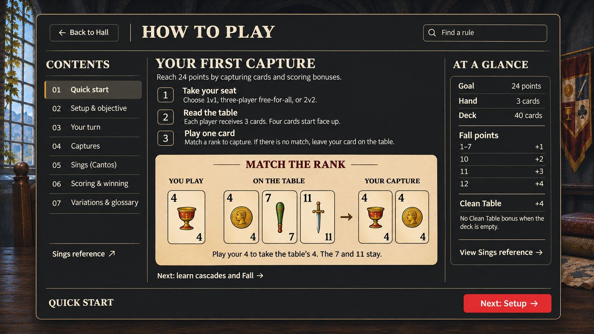
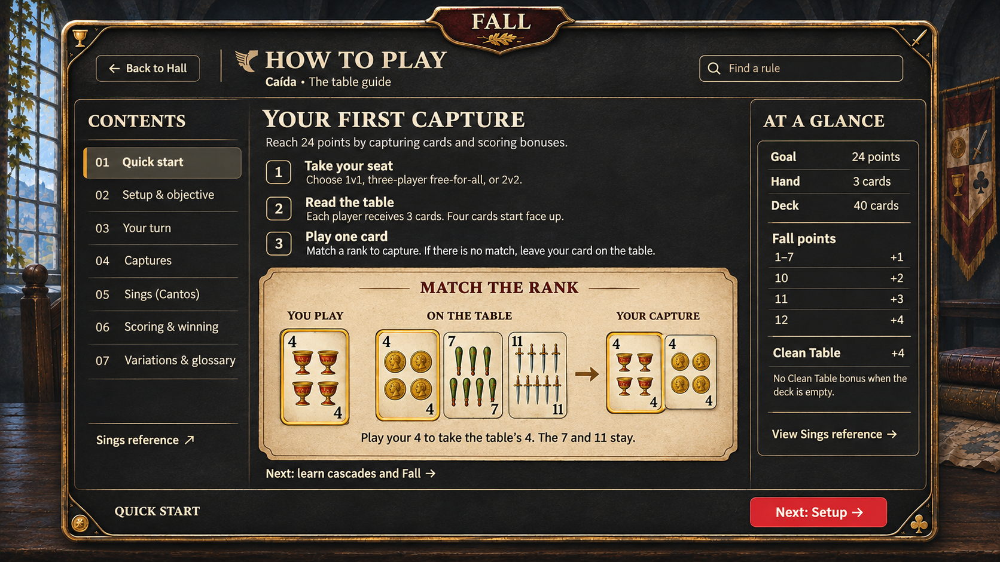

# How to Play — Card Hall rulebook study

Design research and mockups for [#103](https://github.com/Donkijote/fall/issues/103). This PR proposes the guide's organization and appearance; it does not implement the screen or change gameplay. The existing Rules and Sings content defines the intended first-release rules, as confirmed by the owner during this work. Engine discrepancies belong in [bug #109](https://github.com/Donkijote/fall/issues/109), not in revised teaching copy.

## Mockups

| Study                                | Purpose                                                                                                                                |
| ------------------------------------ | -------------------------------------------------------------------------------------------------------------------------------------- |
| [Simplified](how-to-play-simple.png) | Recommended starting point: flat charcoal reading surface, thin brass edge, clear chapter selection, quiet parchment example.          |
| [Detailed](how-to-play-detailed.png) | Same lesson and chapter structure with engraved brass, suit corners and more material detail, continuing the detailed login direction. |

Both are generated 1672 × 941 desktop design studies, not browser captures or working controls. They use the existing [Settings](../settings/README.md) and [login](../main-menu-research/image-concepts/login-detailed.png) studies as visual references. The [exact prompts](prompts.json) record both built-in ImageGen calls. Source game screenshots were inspected for composition; they were not copied into the generated output or redistributed in this repo.

The images illustrate one chapter, not the entire rulebook. The setup sentence is an opening-deal summary; later deals and exceptions belong in Setup. Their first-capture text is one valid action, not an exhaustive statement of whether a player may decline a capture. Production diagrams must use the actual Spanish-deck card component: the detailed image invents pip/face artwork and the simplified image intentionally uses schematic suit marks. Neither generated card face is a runtime asset. Use the exact existing font files/families, theme tokens and component radii when implemented; the raster studies approximate them.

## Reference study and limits

Reviewed every file in `/Users/manuel/Developer/inspirations/how to play`: four still images, no clips. These establish layout, hierarchy and visible states. They do not establish animation durations, opening direction, hover behavior, or whether a depicted gameplay image animates. All motion below is a proposal for Fall, not an observed claim about these games.

| Local reference                         | What is visible                                                                                                                                                                          | What Fall should borrow                                                                                                                                        | What to avoid                                                                                                                        |
| --------------------------------------- | ---------------------------------------------------------------------------------------------------------------------------------------------------------------------------------------- | -------------------------------------------------------------------------------------------------------------------------------------------------------------- | ------------------------------------------------------------------------------------------------------------------------------------ |
| `armello-game-guide.jpg`                | Full-screen illustrated backdrop; long topic rail at left; selected Burning Cards row; short explanation, framed visual sequence, then supporting paragraphs; fixed Back at bottom left. | A visible index, one concept per article, illustration adjacent to the rule, stable return path. The symbolic sequence is especially useful for card captures. | Tiny all-caps reading text, a long alphabetical list as the beginner's only learning path, or text directly over detailed world art. |
| `horizon-forbidden-west-tutorial-3.png` | Notebook context, Tutorials → Traversal → Basic Moves breadcrumb, left list with Sliding selected, large gameplay example, short action text and persistent Close.                       | Distinguish category from article title; pair an action with its result; keep prose short and direct.                                                          | Copying controller prompts before Fall has supported bindings, or treating the still gameplay panel as evidence of video playback.   |
| `frostpunk-research-tutorial.jpg`       | Tutorial summary overlay, topic rail, selected Research state, large scrollable article, annotated workshop-count comparison, Close above content.                                       | Separate navigation from the scrollable reading region; label comparisons directly; make long content and exit discoverable.                                   | Deep frame nesting, full-scene transparency behind paragraphs, or decorative scrolling controls.                                     |
| `frostpunk-construction.jpg`            | Same shell; Construction selected; explanation, labeled build/dismantle icons, then valid/invalid placement comparison; content extends below viewport.                                  | Reuse a predictable article template; show valid and invalid outcomes when useful; alternate prose and small illustrations.                                    | A huge uncaptioned image that forces the reader to infer the rule.                                                                   |

Two additional first-party references broaden the teaching options. [Magic Arena's getting-started page](https://magic.wizards.com/en/mtgarena/getting-started) describes guided learning with Sparky and allows the tutorial to be skipped. [Runeterra's historical patch 2.11 notes](https://playruneterra.com/en-us/news/game-updates/patch-2-11-0-notes/) describe a structured prologue with AI practice, Challenges and later modes. The latter is historical product context, not a claim about its current UI. These support considering optional practice later; they do not justify making Fall's written guide a mandatory onboarding gate. Neither source was used to infer transition timing.

## Recommended destination

Keep `/rules` as a dedicated, route-addressable rulebook, reached from **Hub → Help → How to play**. It needs more reading space and stable links than Settings. Preserve the recognizable Hall around a nearly opaque reading surface. A quiet shell connects it to the world without placing paragraphs over scenery. Avoid literal curved book pages, page-turn animation, or a huge character beside the text.

| Alternative                        | Assessment                                                                                                                                                                                      |
| ---------------------------------- | ----------------------------------------------------------------------------------------------------------------------------------------------------------------------------------------------- |
| Dedicated guide page               | Recommended. Supports chapter links, history, mobile reflow, reading position and long explanations without nested dialogs.                                                                     |
| Large modal over the Hall          | Visually plausible from Frostpunk and existing Settings, but costly for long reading, direct links and nested reference navigation. Keep modal behavior for the existing in-match Sings lookup. |
| Settings section                   | Preferences and rule learning have different purposes. Preserve the separate Help destination established in #104. If entered through Settings in future, retain a contextual return.           |
| One endlessly scrolling article    | Good for sequential reading, harder for quick lookup. Use chapters with a continuous article per chapter and a compact quick reference instead.                                                 |
| Forced wizard or playable tutorial | Future enhancement only. The first version remains written and freely navigable.                                                                                                                |

### Desktop distribution

- Header: Back to Hall (or known originating screen), title, short context, Find a rule.
- Left: numbered learning chapters, selected marker using shape and text as well as color, and a Sings reference shortcut.
- Center: approximately 60–75 characters per text line; chapter title, short rule blocks, one concept per figure, captions with exact outcomes. Main content gets the largest share of width.
- Right, only when space permits: At a glance with goal, hand/deck size, Fall rank values, and the deck-empty Clean Table exception. This is a brief summary, not a second rulebook.
- Bottom: current chapter and Previous/Next chapter actions. The current mockup's inline Captures link is an optional shortcut; Next: Setup follows the numbered reading order. Do not treat Next as a completion or unlock action.

### Mobile and short landscape

At narrow widths, replace the rail with a labeled **Chapters** disclosure and current chapter name. Keep chapters directly reachable; do not make swipe the only navigation. Move At a glance into its own expandable block in the same document, never hide the only copy of a rule. Search results show chapter and excerpt and navigate to a stable heading anchor.

Use one page scroll on mobile with a compact sticky header and safe-area padding. Let the footer flow after the article on short screens rather than cover the last paragraph. The card example reflows into Before / Played card / After groups with a text caption; never shrink the desktop bitmap to fit a phone. Minimum 44px touch targets; visible native scrollbar; no horizontal body scroll at 320px portrait or 568 × 320 landscape. These are implementation requirements, not layouts validated by the desktop concept images.

## Content organization

The [content plan](content-plan.md) maps every existing Rules item into seven chapters and retains the Sings reference data. The quick start introduces a small subset, with explicit links to the full rules and exceptions. This is a second reading path, not a second definition of the game.

| Chapter                  | Reader's question           | Contents                                                                                                               |
| ------------------------ | --------------------------- | ---------------------------------------------------------------------------------------------------------------------- |
| 01 Quick start           | What do I do first?         | Goal, formats, opening layout, one legal same-rank capture, links to Setup, Your turn and Captures.                    |
| 02 Setup & objective     | How does a match begin?     | Deck, dealer selection/ties, direction, opening hand/table, dealer choices and pattern rule.                           |
| 03 Your turn             | What can I do now?          | Sings timing, play/capture/throw, subsequent deals and hand/deal terminology.                                          |
| 04 Captures              | What do I take and why?     | Matching rank, cascade, Fall, Clean Table, explicit exceptions and before/after illustrations.                         |
| 05 Sings (Cantos)        | When do combinations score? | Timing, eligibility, competition/ties, optional/mandatory distinction; link to the complete searchable reference.      |
| 06 Scoring & winning     | Where do points come from?  | Fall values, Clean Table, quotas by format, leftovers, target and agreed Three of a Kind option.                       |
| 07 Variations & glossary | What changes by agreement?  | Existing optional combinations, Three of a Kind choice, deal choices, and real definitions for current glossary terms. |

## Combining the guide and Sings

Share the rulebook shell and visual vocabulary, and cross-link them, while keeping `/sings` as a distinct lookup. The guide explains **when and why** Sings apply. The reference answers **which hand and how many points**, keeping current search by name/tag, minimum-point filter, mandatory-only filter, descriptions, examples and empty state. Do not duplicate its entire catalog inside a long introductory chapter.

Use one source for each combination's pattern, value, eligibility, example and display name. The current `RULES.singsRanking` and `HANDS`/`HAND_META` overlap; a future implementation should reconcile their presentation without dropping any first-release rule, especially the agreed instant-win option absent from the simple points list. A link from the Sings chapter can open `/sings`; Back returns to the same chapter and position. Direct visits get a reliable Hall fallback. In-match View sings remains a modal and must not navigate away or reset the match.

The illustration system can be shared: a labeled three-card hand for each Sing, and a labeled table/played/capture figure for a play. These are distinct concepts. Do not use a Sings hand as though it were a legal table capture. Prefer existing live card components and text labels over generating one bitmap per rule, so localization, zoom and accessibility work.

## Teaching possibilities

| Priority            | Idea                                    | Shape and dependency                                                                                                                                                                |
| ------------------- | --------------------------------------- | ----------------------------------------------------------------------------------------------------------------------------------------------------------------------------------- |
| First written guide | Static before/action/after card figures | Captions explain every outcome; card images supplement live text. Reuse existing deck art. The verified basic example is in both mockups.                                           |
| First written guide | Valid / does not apply comparisons      | Show Fall versus a later matching capture; Clean Table with cards in deck versus deck empty. Verify fixtures against intended rules and fix #109 before shipping affected examples. |
| First written guide | Format comparison                       | One compact quota table: 1v1, three-player, 2v2. Keep shared rules once; label the dealer's three-player exception clearly.                                                         |
| First written guide | Search, anchors and contextual links    | Local written-content search; matched heading and excerpt; link from relevant paragraph to a Sing or glossary term. No remote service required.                                     |
| Later               | Step through a sample play              | Optional Previous/Next example controls reveal before/action/after; accessible text always available. Requires deterministic fixtures and verified collection/scoring.              |
| Later               | “Which card would you play?”            | Optional untimed knowledge check with explanation; no completion gate or invented rewards. Requires answer validation against the actual rules.                                     |
| Later               | Guided practice against a bot           | Returnable learning action in Help; no leaderboard effects; requires isolated match state, reliable reset and rule-engine fixes. Not a promised control in these mockups.           |
| Later               | Contextual first-match hints            | Only where the player acts; dismissible and replayable. Avoid opening a full tutorial over an active turn. Requires UX testing and preference design.                               |

## Motion and accessibility specification

Use GSAP/`@gsap/react` for any DOM motion. Proposed entry: a 160–180ms surface fade with at most 8px vertical movement, stationary Hall. Chapter navigation may use a brief 100–140ms content fade; update the heading and focus without animating the page height. Immediate static hover/focus styling is sufficient. A future step-through figure can use a short card movement only after explicit activation; no autoplay. Reduced motion applies final states immediately. Clean up contexts/listeners; no CSS transitions, keyframes or inherited primitive transitions.

Implement chapters as navigation links with a current-state indication, headings in a consistent hierarchy, figures with captions, properly labeled search/disclosure controls, and a search result/empty-result announcement. Decorative Hall art, frames and duplicate visual arrows stay out of the accessibility tree. Each card needs an understandable rank/suit label; describe captures in prose so the diagram is not the only explanation. Color alone must not identify captured versus remaining cards. Restore the originating focus on return; focus the chapter heading after explicit chapter navigation without stealing focus during search typing. Avoid the current blocking first-visit HintModal: Quick start is directly visible.

Use existing Cinzel/Spline Sans, `background`, `card`, foreground pairs, `muted`, `border`, `input`, `ring`, `primary` and shared `gold` in both themes. Reuse ActionButton and the shared brass surface treatment outside generated primitives; use `rounded-md` for controls and framed surfaces. No new component palette, radius, or token is needed. Dark mockups do not supersede light or System appearance support.

## Implementation gate and review

- Choose the visual treatment; these studies are proposals, not approval or implementation.
- Preserve every item in the content inventory and resolve the explicitly unfinished/ambiguous wording there without inventing a rule.
- Resolve #109 before teaching affected scoring/cascade examples as working gameplay. Other audit questions are listed separately in the content plan.
- Implement responsive layouts and verify light/dark, keyboard, zoom, reduced motion, long copy, direct visits, chapter/history/scroll restoration, Sings round trips and match continuity. Reuse the running port 3000 app; no new server.
- Keep reference masters in `docs/design`; any future runtime art must be exported under `src/assets`, with live controls/text kept separate.

## Validation of this study

Inspected all four supplied stills and the existing design masters; read the Rules screen, Sings screen and their data sources; inspected relevant deal, move, scoring, Sings and service code. Visually reviewed both generated images for text, hierarchy, chapter coverage, card example and reference values. The simplified version improves schematic card legibility. Production card fidelity and responsive behavior still require implementation validation.

A temporary fixture exercised the mockup's exact play through `analyzePlay`, hand removal, the service-style played-card table insertion and `updateTableAndHandCards`: cups-4 captures coins-4; clubs-7 and swords-11 remain; the collected pile contains exactly the two 4s. Five additional diagnostic cases reproduced #109 (three pair ranks, optional Big House disabled, and cascade collection). These probes were removed after the research; no diagnostic assertions of incorrect behavior ship as regression tests. Existing moves, scoring, deal, resolveHands and hands suites plus the initial example fixture passed: 39 tests in six files. The subsequent six focused probe cases also passed, confirming the recorded current outcomes. See #109 for the required expected-behavior tests.
