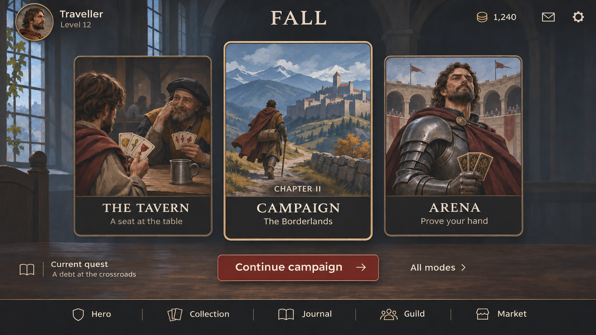

# Fall — active Card Hall design

`card-hall.png` is the current working master (1672 × 941). Edit this file in place.
The accepted three-card composition uses simplified painted artwork, thin bronze
frames, warm charcoal surfaces, a red primary action and consistent line icons.
Typography approximates the project's Cinzel and Spline Sans families.

[prompts.json](prompts.json) preserves this image's generation prompt, refinements
and source history from the built-in image tool. The illustration is a flattened
visual mockup; labels and controls should become real UI components during
implementation. Progress, currency and future destinations are illustrative.
